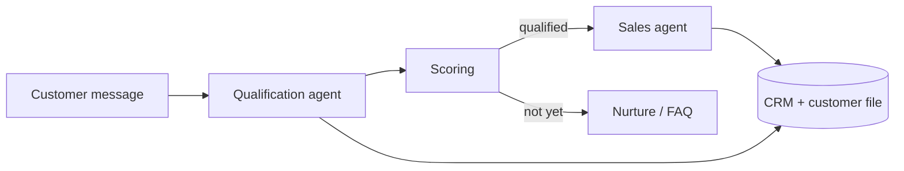

# Lead Qualification Agents for a Services Business

Every inquiry gets the same first five questions, a score, and a clean file for the sales team, before a human reads a single message.

> **Case study.** Source code is private. The business problem, the design decisions and the stack are documented here.

## The problem

A services business was losing time on inquiries that were never going to convert, while good ones waited in the same queue. The first conversation needed to be consistent, in the customer's language, and end with something a salesperson could act on.

## What was built

- **Qualification conversation** that collects the details sales actually needs
- **Scoring** so hot and cold leads are separated automatically
- **Surveys** to capture structured answers instead of free text
- **Customer files and CRM sync**, so nothing lives only in a chat window
- **Sales agent** that continues the conversation once a lead qualifies

## How it fits together

## Stack

Conversational AI platform · LLM APIs · CRM integration · Webhooks

## Status

Qualification flows built; further bots scoped with the client.

---

Questions about the build, or a similar system for your business? **info@hamedsamii.com**
